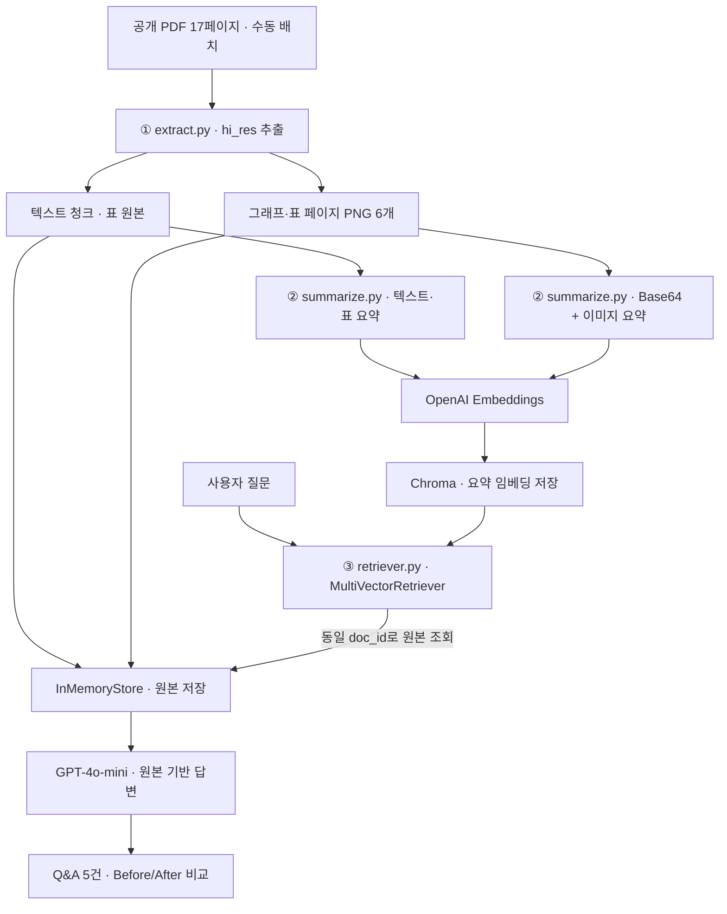
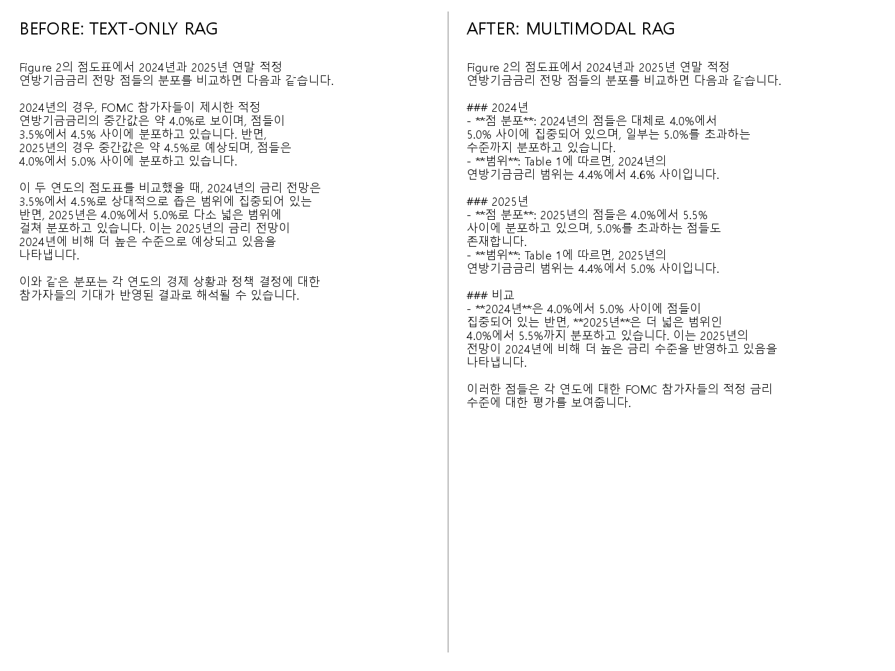

# Federal Reserve SEP | Multimodal RAG

**미국 연방준비제도 경제전망 보고서 기반 멀티모달 RAG — 개인 과제**

`Python 3.11` · `LangChain` · `Unstructured` · `PyMuPDF` · `GPT-4o-mini` · `ChromaDB`

> PDF의 **텍스트·표·그래프**를 추출하고, **요약으로 검색한 다음 원본으로 답변**하는 멀티모달 RAG를 구현했습니다. 수업의 01·02·03 Jupyter 실습을 `extract.py` → `summarize.py` → `retriever.py`로 연결하고, 실행 결과를 별도 노트북에 기록합니다.

## 1. 문제 정의 및 PDF 선정

경제전망 보고서는 본문만 읽어서는 파악하기 어려운 **수치표(Table)**, **금리 점도표(Dot Plot)**, **불확실성 그래프**를 포함합니다. 텍스트 전용 RAG와 이미지까지 활용하는 멀티모달 RAG를 같은 질문으로 비교해 검색 근거와 답변 정확성을 살펴봤습니다.

| 항목 | 내용 |
|---|---|
| 자료 | Federal Reserve, *Summary of Economic Projections*, 2024.12.18 |
| 분량 및 공개 여부 | **17페이지**, 공식 공개 PDF |
| 주요 표 | Table 1 — 경제전망(p.2), Table 2 — 역사적 전망 오차(p.16) |
| 주요 그래프 | Figure 1(p.3), Figure 2 금리 점도표(p.4), Figure 4.A GDP 불확실성(p.10) |
| PDF 원문 | [Federal Reserve 공식 PDF](https://www.federalreserve.gov/monetarypolicy/files/fomcprojtabl20241218.pdf) |

수업에서 사용한 `invest.pdf`가 아닌 별도 자료이며, **2024년 12월 당시 전망**을 분석합니다.

## 2. 아키텍처



### 왜 요약으로 검색하고 원본으로 답변할까?

요약은 긴 본문과 이미지에 담긴 핵심 의미를 짧게 표현하므로 임베딩 검색에 유리합니다. 반면 요약만 사용하면 **표의 행·열 관계나 그래프의 점 분포, 숫자와 범례**가 생략될 수 있습니다. 따라서 **요약은 Chroma**, **원본은 InMemoryStore**에 같은 `doc_id`로 연결해 저장하고, 검색된 원본을 LLM에 전달했습니다.

## 3. 디렉터리 구조

```text
multimodal-rag/
├── src/
│   ├── extract.py                  # PDF 추출·분할
│   ├── summarize.py                # 텍스트·표·이미지 요약
│   └── retriever.py                # 검색·답변·평가 결과 생성
├── notebooks/
│   └── SEP_Multimodal_RAG_Execution.ipynb
├── data/
│   ├── fed_sep_2024_12.pdf         # 직접 배치 · Git 제외
│   ├── figures/                   # 추출 이미지 · Git 제외
│   └── processed/                 # extracted.pkl / summaries.pkl · Git 제외
├── results/
│   ├── qa_results.json
│   ├── qa_results.md
│   ├── before_after.txt
│   └── before_after.png
├── .env.example
├── .gitignore
├── requirements.txt
├── requirements.lock.txt          # 실행 환경에서 생성
└── README.md
```

## 4. 실행 방법

**환경:** Windows 11 · Python 3.11.9 · VS Code · Git Bash. OS에 **Poppler**와 **Tesseract**를 별도로 설치하고 PATH에 등록해야 합니다.

```bash
# 클론한 저장소 루트에서 실행
python -m venv .venv
source .venv/Scripts/activate
python -m pip install -r requirements.txt

# .env가 없는 경우에만
cp .env.example .env
# .env에 OPENAI_API_KEY=실제키 설정 (Git에 업로드 금지)

# 공식 PDF를 직접 data/fed_sep_2024_12.pdf에 배치
python src/extract.py
python src/summarize.py
python src/retriever.py
```

`src/summarize.py`는 `extracted.pkl`의 **`figure_names`에 기록된 PNG 6개만** 요약하므로 다른 JPG가 폴더에 남아 있어도 검색 대상에 넣지 않습니다. 요약과 임베딩, 답변 생성에는 OpenAI API 사용 비용이 발생합니다.

**제출용 노트북:** [SEP_Multimodal_RAG_Execution.ipynb](notebooks/SEP_Multimodal_RAG_Execution.ipynb) — `.venv` 커널을 선택하고 `RUN_SCRIPTS = False` 상태로 전체 실행한 뒤, **출력이 남은 상태로 저장**합니다. 기존 `pkl`과 `results/`를 읽으므로 API 중복 호출이 필요하지 않습니다.

## 5. 기술 선택 근거

| 구성 | 선택 이유 |
|---|---|
| `partition_pdf(strategy="hi_res")` | 텍스트와 표를 레이아웃 기반으로 분류 |
| PyMuPDF | PDF의 벡터형 그래프 페이지를 PNG로 보존 |
| 청크 크기 2,000 / overlap 200 | 수업 설정을 유지하면서 경계 문맥 손실 완화 |
| `gpt-4o-mini`, `temperature=0` | 텍스트·표·이미지 한국어 요약 및 답변, 변동성 축소 |
| 한국어 프롬프트 | 한국어 질문·검색용 요약·답변을 일관되게 구성 |
| `text-embedding-3-small` | 요약문 의미 기반 임베딩 검색 |
| Chroma + MultiVectorRetriever + InMemoryStore | 요약 검색과 원본 반환을 `doc_id`로 연결 |
| `k=8` | 검색 시 텍스트·표·이미지 근거를 폭넓게 조회 |

## 6. 실제 실행 결과 (수정 후 재실행)

| 단계 / 항목 | 실제 출력 |
|---|---:|
| 원본 PDF | **17페이지** |
| 추출된 전체 요소 | 16개 |
| 텍스트 블록 / 표 객체 | **13개 / 3개** |
| 텍스트 청크 | 5개 |
| 별도 렌더링한 표·그래프 PNG | **6개** |
| PDF 추출 시간 | 96.0초 |
| 텍스트 요약 / 표 요약 | **5개 / 3개** |
| 텍스트·표 요약 시간 | 37.0초 |
| 이미지 요약 | **6개** |
| 이미지 요약 시간 | 26.5초 |
| 벡터 DB 저장 요약 문서 | **14개** |
| 비교 질문에서 검색된 원본 | 8개 (이미지 4개 + 텍스트·표 4개) |
| 첫 비교 질문 답변 시간 | 14.3초 |
| 최종 질의응답 | **5건** |

**개선 이력:** 초기 실행은 이미지 12개를 처리했으며, 그중 일부에서 경제전망과 무관한 OCR 관련 설명이 생성됐습니다. 이미지 폴더를 통째로 순회하던 코드를 변경해 **이번 PDF에서 지정한 PNG 6개만 요약**했고, 재실행 결과 이미지 6개·벡터 문서 14개를 확인했습니다.

다만 텍스트 요약 일부에는 서로 다른 경제지표의 숫자가 섞이는 오류가 관찰되어, **요약이 성공했다고 해서 정확성을 보장하지는 않습니다.**

## 7. 질의응답 5건 — 실제 모델 출력 요약

아래 답변은 **최종 재실행에서 생성된 모델 답변을 요약한 것**입니다. 수치 검증 결과는 9절에서 별도로 구분합니다.

<!-- QA_RESULTS_START -->
| 번호 | 질문 | 실제 모델 답변 요약 | 검색된 원본 종류 |
|---|---|---|---|
| 1 | Table 1: 2025년 GDP·실업률·PCE 중앙값은? | **2.1%, 4.3%, 2.5%**라고 답변 | 표·텍스트·이미지 |
| 2 | Figure 2: 2024/2025년 금리 점 분포 비교 | 2024년 4.4~4.6%, 2025년 **4.4~5.0%** 범위라고 답변했으나 **2025년 값은 오류** | 이미지·표·텍스트 |
| 3 | Figure 1: 2024~2027년 GDP·실업률 전망 | GDP **2.5→2.1→2.0→1.9%**, 실업률 **4.2→4.3→4.3→4.3%** | 이미지·표·텍스트 |
| 4 | Table 2: 2027년 역사적 전망 오차 | GDP **±2.3%p**, 실업률 **±2.0%p** | 표·이미지·텍스트 |
| 5 | Figure 4.A: GDP 전망 불확실성 | **70% 신뢰구간**과 위험·불확실성 평가를 설명. 일부 참가자 수는 별도 검증 필요 | 이미지·표·텍스트 |
<!-- QA_RESULTS_END -->

- [전체 답변 및 검색 근거 (Markdown)](results/qa_results.md)
- [기계 판독 가능한 결과 (JSON)](results/qa_results.json)

검색된 원본 유형은 **실제로 전달된 자료의 종류**이며, 답변의 모든 문장이 해당 자료로 뒷받침된다는 자동 판정은 아닙니다. `retriever.py`를 다시 실행하면 위 표는 자동 갱신됩니다.

## 8. Before / After 비교

**동일 질문:** “Figure 2의 점도표에서 2024년과 2025년 연말 적정 연방기금금리 전망 점들의 분포를 비교해 주세요.”

| 조건 | BEFORE: 텍스트 RAG | AFTER: 멀티모달 RAG |
|---|---|---|
| 검색 자료 | 텍스트 요약만 | 텍스트·표·이미지 요약 |
| 답변 근거 | 텍스트 원본 | 텍스트·표·PNG 원본 |
| 검색 구조 | MultiVectorRetriever | MultiVectorRetriever |
| 공통 설정 | `gpt-4o-mini`, 동일 프롬프트, `k=8` | `gpt-4o-mini`, 동일 프롬프트, `k=8` |



[Before/After 전체 답변 텍스트](results/before_after.txt)

**관찰:** BEFORE는 2024년 3.5~4.5%, 2025년 4.0~5.0%라고 답했고, AFTER는 2024년 4.4~4.6%라는 Table 1 값은 인식했으나 **2025년을 4.4~5.0%라고 잘못 해석**했습니다. 모델에 이미지가 전달됐다는 점은 확인했으나, **이미지 활용이 답변 정확도 향상을 보장하지 않았습니다.** 또한 검색 데이터 구성이 다르므로 완전히 통제된 인과 비교는 아닙니다.

## 9. 원본 PDF 검증 및 한계

| 질문 | 원본 대조 결과 | 비고 |
|---|---|---|
| Q1 | ✅ 일치 | 2025년 GDP **2.1%**, 실업률 **4.3%**, PCE **2.5%** (Table 1, p.2) |
| Q2 | ❌ 수치·방향 오류 | 실제 금리 중앙값 **2024년 4.4% → 2025년 3.9%**, Range **4.4~4.6% → 3.1~4.4%** (Table 1, p.2 / Figure 2, p.4) |
| Q3 | ✅ 핵심 수치 일치 | GDP **2.5→2.1→2.0→1.9%**, 실업률 **4.2→4.3→4.3→4.3%** (p.2~3) |
| Q4 | ✅ 핵심 수치 일치 | 2027년 GDP **±2.3%p**, 실업률 **±2.0%p** (Table 2, p.16) |
| Q5 | ⚠️ 부분 검증 | 파란 선=실제값, 빨간 선=전망 중앙값, 연한 파란 영역=**70% 신뢰구간** (Figure 4.A, p.10). 참가자 수와 세부 해석은 추가 대조 필요 |

**확인된 한계와 개선 방향**

1. **이미지·텍스트 요약 오류:** 이미지 또는 문장을 요약하면서 숫자와 지표를 혼동할 수 있어 원본 표 수치 검증이 필요합니다.
2. **점도표 해석 오류:** 그래프의 축 전체 범위와 실제 점 범위를 혼동하므로, Table 1의 Range와 교차 검증해야 합니다.
3. **출처 페이지 정보:** 이미지 파일명에는 페이지를 저장했지만 텍스트·표 원본에는 페이지 메타데이터가 충분하지 않습니다.
4. **저장소 수명:** `InMemoryStore`는 프로세스 종료 후 유지되지 않아 검색기를 재구성해야 합니다.
5. **비교 실험:** 두 체인의 데이터 유형이 다르고 출력에 오류가 있으므로, 동일 검색 조건을 추가로 통제하고 근거 정확도 지표로 평가할 필요가 있습니다.

## 10. 제출 점검

- [x] 수업과 다른 공개 PDF 선정 · 10~30페이지 · 표/그래프 포함
- [x] 텍스트·표·이미지 추출 및 `data/figures/` 생성
- [x] 텍스트·표·이미지 요약 및 검색·체인 재실행
- [x] Q&A 5건과 Before/After 결과 파일 생성
- [x] 아키텍처, 구조 이해, 기술 선택 근거, 한계 작성
- [x] **제출용 `.ipynb` 전체 셀 실행 후 출력 포함 저장**
- [x] `.env`·PDF·중간 데이터의 Git 추적 제외 확인
- [x] `requirements.lock.txt` 생성 및 공개 GitHub 푸시 확인
- [x] GitHub에서 이미지·노트북·README 표시 확인 후 저장소 링크 제출

> 이 저장소는 공개된 **2024년 12월 SEP 보고서를 대상으로 한 학습용 실험**이며 현재 경제전망이나 투자 조언을 제공하지 않습니다.
